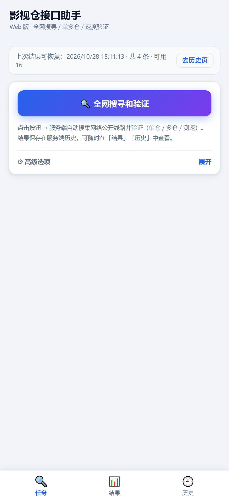
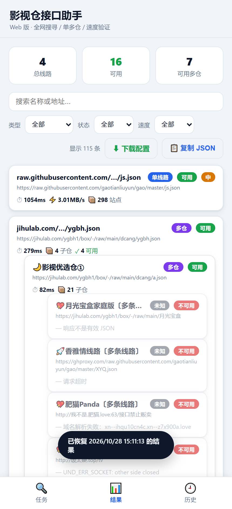
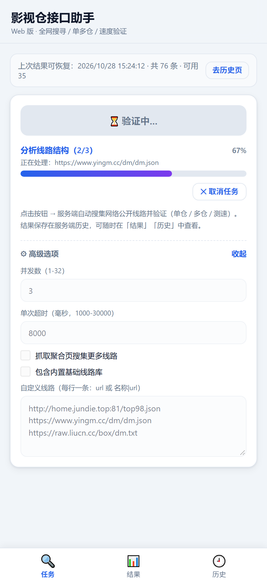
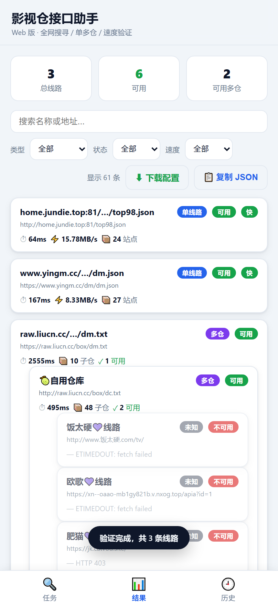
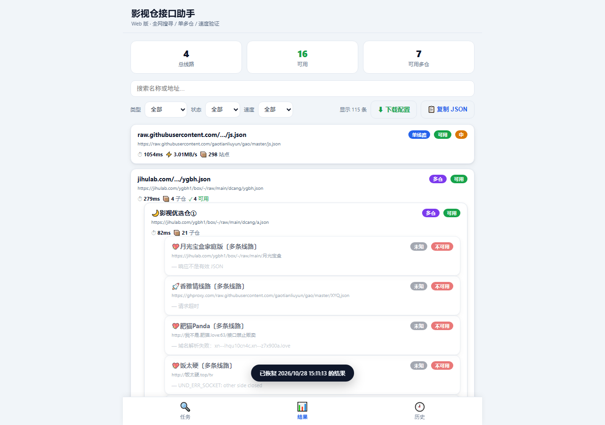
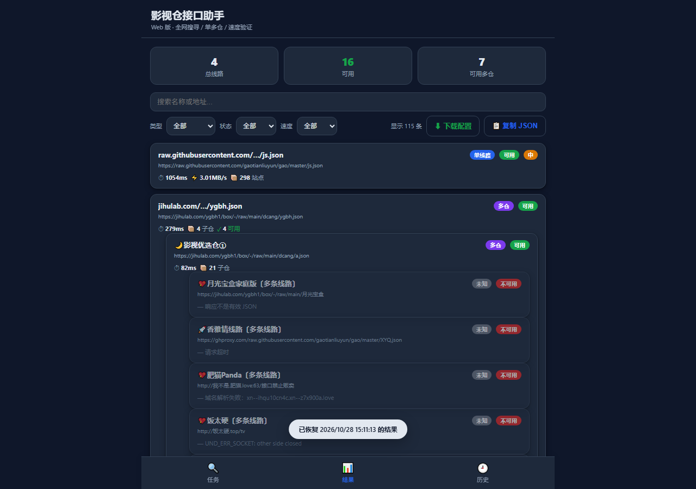

# 影视仓接口助手 · Web / Docker 版

把原 `影视仓接口助手_1.0.apk`（82 KB 的 WebView 壳 + 单文件 HTML）改造成**不依赖 Android、可网页访问、可 Docker 部署**的服务。

原 APK 的全部逻辑都在 `assets/index.html` 里：抓取公开线路 → 递归识别单仓/多仓 → 多采样测速 → 生成影视仓可直接导入的 `{"urls":[...]}` 配置。
其中"抓取"依赖 Java 桥 `YscAndroid.captureAsync` 来绕过浏览器 CORS —— 这正是它不能直接当网页用的根因。

Web 版把这一步挪到服务端：**零依赖 Node 服务端**负责抓取/分析/测速/持久化，浏览器只管 UI。

```
浏览器 (public/)  ──HTTP + SSE──▶  Node 服务端 (server.mjs + src/)  ──HTTPS──▶  各线路源站
```

## 特性

- **零 npm 依赖**：只用 Node 内置模块，`npm install` 都不用跑；镜像 240 MB（几乎全是 `node:22-alpine` 基础层）。
- **服务端扫描**：扫描在后台 job 里跑，页面刷新/关掉都不中断；SSE 实时推送阶段、百分比与当前 URL。
- **不再受 CORS 限制**：服务端直连源站，抓取能力与 APK 原生桥等价。
- **服务端历史**：结果落盘到 `DATA_DIR`，换设备/换浏览器也能恢复，最多保留 `MAX_HISTORY` 条。
- **多仓递归展开**：与原版一致，最多 4 层、每层 100 个子仓。
- **可配置线路源**：内置基础线路 + 聚合页，支持 `config/sources.json` 覆盖，或在界面「高级选项」里临时追加。
- **SSRF 防护**：默认拒绝内网/回环地址，避免把代理接口暴露成内网探测工具。

## 界面

| 任务页（移动端） | 结果页（移动端） |
|---|---|
|  |  |

| 扫描中（SSE 实时进度） | 实时结果（含子仓展开） |
|---|---|
|  |  |

| 结果页（桌面端） | 深色模式 |
|---|---|
|  |  |

## 目录结构

```
.
├─ server.mjs            # HTTP 入口：路由 / 静态 / SSE / Basic Auth
├─ src/
│  ├─ fetcher.mjs        # 计时抓取 + 超时 + 体积截断 + SSRF 防护
│  ├─ analyze.mjs        # 类型识别、递归展开、测速、配置生成
│  ├─ sources.mjs        # 内置线路与聚合页（config/sources.json 可覆盖）
│  ├─ jobs.mjs           # 扫描任务与进度事件
│  ├─ store.mjs          # 历史持久化
│  └─ util.mjs           # URL/JSON/并发工具
├─ public/               # 前端（index.html + style.css + app.js，无构建）
├─ test/smoke.mjs        # 离线端到端验收测试
├─ config/
│  └─ sources.example.json # 复制为 sources.json 即可覆盖内置线路源
├─ data/                 # 运行期生成：历史记录（Docker 用命名卷 ysc-data）
├─ docs/
│  ├─ API.md             # 接口契约（前后端唯一约定）
│  ├─ backend-selftest.md# 服务端自测报告
│  └─ screenshots/       # 界面截图
├─ reference/apk/        # 原 APK 解包产物（仅存档对照，不参与运行）
├─ Dockerfile
└─ docker-compose.yml
```

## 本地运行

需要 Node.js ≥ 20（推荐 22 LTS），**无需 npm install**。

```bash
node server.mjs
# 打开 http://127.0.0.1:8080
```

自定义端口 / 数据目录：

```bash
PORT=9000 DATA_DIR=./data node server.mjs     # Linux / macOS
```
```powershell
$env:PORT=9000; node server.mjs               # Windows PowerShell
```

## Docker 部署

### 方式一：compose（推荐）

```bash
docker compose up -d
# 访问 http://<服务器IP>:8080
```

`docker-compose.yml` 已配好命名卷 `ysc-data`、`TZ=Asia/Shanghai`、健康检查与自动重启。

公网部署先复制环境变量模板（compose 会自动读取同目录 `.env`）：

```bash
cp .env.example .env      # 然后编辑里面的 BASIC_AUTH=用户名:密码
docker compose up -d --build
```

> **为什么用命名卷而不是 `./data`**：容器以非 root（uid 10001）运行，Linux 上直接绑定挂载宿主机目录会因属主不符而写不了历史。
> 命名卷首次创建时会继承镜像里 `/app/data` 的属主，开箱即用。
> 若确实要用宿主机目录备份，改成 `- ./data:/app/data` 并先执行 `mkdir -p data && sudo chown -R 10001:10001 data`。

**拉不到基础镜像时**（Docker Hub 在国内常超时）：基础镜像可用构建参数替换，例如

```bash
BASE_IMAGE=docker.1ms.run/library/node:22-alpine docker compose up -d --build
# 或
docker build --build-arg BASE_IMAGE=docker.1ms.run/library/node:22-alpine -t ysc-helper:1.0.0 .
```

### 方式二：纯 docker

```bash
docker build -t ysc-helper:1.0.0 .
docker run -d --name ysc-helper \
  -p 8080:8080 \
  -v ysc-data:/app/data \
  -e TZ=Asia/Shanghai \
  --restart unless-stopped \
  ysc-helper:1.0.0
```

（要挂宿主机目录就换成 `-v "$PWD/data:/app/data"`，并先 `sudo chown -R 10001:10001 data`；
想对外开 Basic Auth 再加 `-e BASIC_AUTH=user:pass`。）

### 反向代理（可选）

放在 Nginx / Caddy 后面时注意 **SSE 不能缓冲**，否则进度条会一直卡在 0%：

```nginx
location / {
    proxy_pass http://127.0.0.1:8080;
    proxy_http_version 1.1;
    proxy_set_header Host $host;
    proxy_set_header Connection "";
    proxy_buffering off;              # 关键：SSE 必须关闭缓冲
    proxy_read_timeout 3600s;
}
```

Caddy 默认不缓冲，直接 `reverse_proxy 127.0.0.1:8080` 即可。

## 环境变量

| 变量 | 默认 | 说明 |
|---|---|---|
| `PORT` | `8080` | 监听端口 |
| `HOST` | `0.0.0.0` | 监听地址 |
| `DATA_DIR` | `./data` | 历史落盘目录 |
| `ALLOW_PRIVATE_TARGETS` | `0` | `1` = 允许抓内网/回环地址 |
| `SCAN_CONCURRENCY` | `8` | 全局最大并发抓取数 |
| `REQUEST_TIMEOUT_MS` | `8000` | 单次抓取默认超时 |
| `MAX_HISTORY` | `20` | 历史保留条数（超出删最旧） |
| `MAX_RUNNING_JOBS` | `8` | 同时运行的扫描任务上限 |
| `BASIC_AUTH` | 空 | `user:pass`，非空则启用 HTTP Basic 认证 |
| `FETCH_UA` | `okhttp/4.12.0` | 抓取时使用的 User-Agent（与原 APK 一致） |
| `CONFIG_DIR` | `./config` | 线路源覆盖文件目录 |
| `PUBLIC_DIR` | `./public` | 前端静态目录 |
| `TZ` | `Asia/Shanghai` | 容器时区 |

**公网部署务必设置 `BASIC_AUTH`**：这个页面会把服务端变成通用 HTTP 抓取器。

## 测试

```bash
node test/smoke.mjs
```

完全离线（自建 fixture 源站，不访问外网），13 个用例覆盖抓取/SSRF/扫描/SSE/配置下载/历史/鉴权/错误码。

容器内复跑（镜像里不含 `test/`，用挂载即可）：

```bash
docker run --rm -v "$PWD:/app" -w /app --entrypoint node ysc-helper:1.0.0 test/smoke.mjs
```

Windows PowerShell 下 `npm test` 可能被执行策略拦截，直接用 `node test/smoke.mjs` 最稳。

## 与 APK 版的差异

| 能力 | APK 版 | Web 版 |
|---|---|---|
| 抓取 | Java 桥 `captureAsync`（绕 CORS） | 服务端直连，能力等价 |
| 运行位置 | 手机本地 | 服务端（可 7×24） |
| 页面关闭 | 任务中断 | 任务继续，重连即见 |
| 结果存储 | `localStorage`（本机 8 条） | 服务端磁盘（多设备共享） |
| 配置下载 | 系统「另存为」对话框 | 浏览器下载 / 复制 JSON |
| 网络要求 | 手机直连 | 服务器可出网（国内源站建议境外/国内均可达的出口） |

## 已知限制

- 线路源多为第三方公益地址，**随时可能失效**；失效条目前会标红并显示原因（超时 / HTTP 4xx / 非 JSON / 结构不可识别）。
- 单次全量扫描（约 90 条基础线路 + 聚合页提取）耗时取决于源站响应，慢源会拖长整体时间；可调小超时或减少并发等待。
- 速度分级沿用原版阈值：< 500 ms 快、< 2000 ms 中、< 5000 ms 慢，其余不可用。
- **任务状态在内存里**：服务重启/容器重建后，运行中的任务会丢失（`GET /api/jobs/:id` 返回 404），
  已完成的扫描结果因为落盘到历史而保留。长时间无人值守时不必担心，重启只需重跑一次。
- 抓取的是公开配置，请自行判断内容合法性与使用风险。

## 网络与代理

- 服务端**不支持 HTTP(S) 代理环境变量**（Node 内置 fetch 无代理支持），需要代理的出口请用 TUN/透明代理，
  或 `docker run --network host` 配合宿主机代理规则。
- 国内线路源大多可直连；`raw.githubusercontent.com` / `gitlab.com` 一类源站经常超时，
  这类条目会被标为不可用并显示原因（超时 / ETIMEDOUT / 域名解析失败 / 响应不是有效 JSON），属预期表现，多跑几次可用性会变化。
- 抓取并发由 `SCAN_CONCURRENCY` 全局限制（默认 8），源站敏感时可下调，避免被限流或拉黑。

## 发布镜像 / 同步到 GitHub

本机构建后推到自己的 Docker Hub（把 `<your-dockerhub-id>` 换成你的账号）：

```bash
docker login -u <your-dockerhub-id>
docker tag ysc-helper:1.0.0 <your-dockerhub-id>/ysc-helper:1.0.0
docker tag ysc-helper:1.0.0 <your-dockerhub-id>/ysc-helper:latest
docker push <your-dockerhub-id>/ysc-helper:1.0.0
docker push <your-dockerhub-id>/ysc-helper:latest
# 别处部署：docker run -d -p 8080:8080 -v ysc-data:/app/data <your-dockerhub-id>/ysc-helper:latest
```

推到 GitHub 后，`.github/workflows/docker-publish.yml` 会在 push 到 `main`、打 `v*` 标签或手动触发时
自动构建并推 Docker Hub。需要在仓库 Settings → Secrets 里配置：

| Secret | 说明 |
|---|---|
| `DOCKERHUB_USERNAME` | Docker Hub 用户名 |
| `DOCKERHUB_TOKEN` | Docker Hub Access Token（Read & Write，**不要用账号密码**） |

未配置 secret 时工作流只构建不推送（不会因为缺凭据失败）。

## 许可

仅用于个人学习与网络自检。原 APK 版权归其作者。
